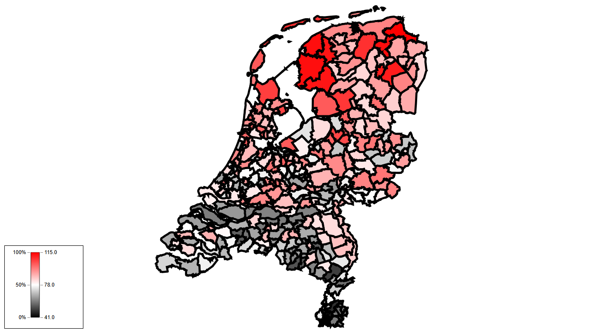
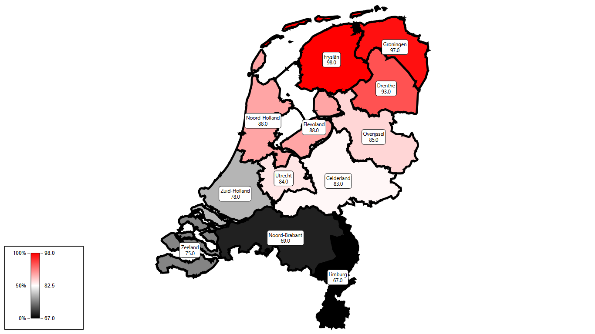
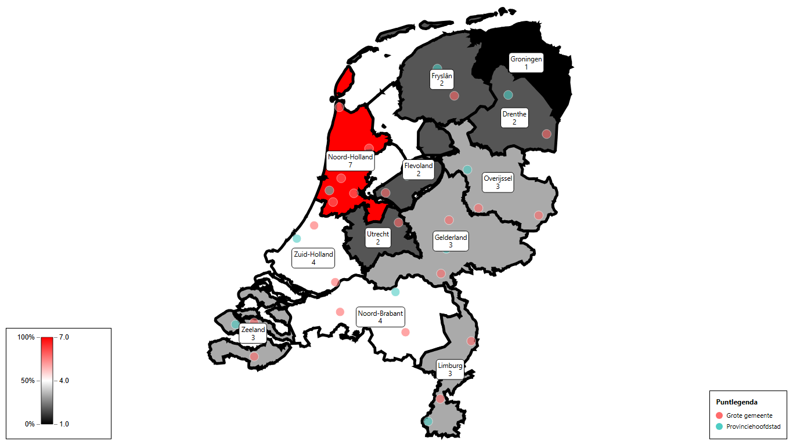

# Nederlandse Regiokaarten

Power BI custom visual with **Dutch regional maps**: municipalities (gemeenten), provinces (provincies), and optional point overlays.



## Features

- Choropleth maps for **gemeenten** and **provincies**
- Match regions by **CBS statcode** (`GM0014`, `PV20`, …) — recommended — or by name
- Mid-color / continuous color scale with legend
- Region labels and values (toggleable)
- Latitude / longitude **points** with category colors and legend
- **Filter** on regions (CBS `statcode` from the topojson) while showing points or cluster bubbles
- Built-in CBS-style region geometry (no external basemap required)

## Install

1. Download the latest `.pbiviz` from [Releases](https://github.com/TacodeJong/nederlandseRegiokaarten/releases) or build locally (`npm install` → `pbiviz package`).
2. In Power BI Desktop: **Insert → More visuals → From a file** and select the `.pbiviz`.

## Sample data

| File | Description |
|------|-------------|
| [`samples/kaarten-sample.csv`](samples/kaarten-sample.csv) | Catalog of available map layers |
| [`samples/gemeenten-sample.csv`](samples/gemeenten-sample.csv) | Scores per gemeente (statcode) |
| [`samples/provincies-sample.csv`](samples/provincies-sample.csv) | Scores per provincie (statcode) |
| [`samples/punten-sample.csv`](samples/punten-sample.csv) | Point locations |
| [`samples/ggd-sample.csv`](samples/ggd-sample.csv) | GGD regions (CBS `GG####` from topojson) |
| [`samples/locaties-sample.csv`](samples/locaties-sample.csv) | Fictitious locations linked to GGD |
| [`samples/pbip/NLMap-sample.pbip`](samples/pbip/NLMap-sample.pbip) | Power BI Project with the visual embedded |

The sample report opens on **Puntdata**: GGD basemap + locations (status legend) + GGD slicer. **Clusterbubbles** is the same setup with clustering on. Locaties relate to GGD on `GGDStatcode` → `Statcode`, so the slicer filters points without putting GGD fields in the visual wells.

> Fictitious demo data only. Do not publish real organisational `.pbix` files (e.g. production Koeltorens) to this public repo.

## Screenshots

| | |
|:--:|:--:|
|  |  |
| *Provinces* | *Points on provinces* |

## Local preview (screenshots)

```bash
npm install
npx esbuild demo/main.ts --bundle --format=iife --target=es2019 --outfile=demo/preview.js --loader:.json=json --loader:.less=empty
```

Open `demo/preview.html?view=gemeenten` (or `provincies` / `punten`) in a browser.

## Build

```bash
npm install
pbiviz package
```

Requires [Node.js](https://nodejs.org/) and the [Power BI Visuals Tools](https://learn.microsoft.com/en-us/power-bi/developer/visuals/environment-setup) (`pbiviz`).

## Author

T. de Jong — [tictaco.nl](https://tictaco.nl)
